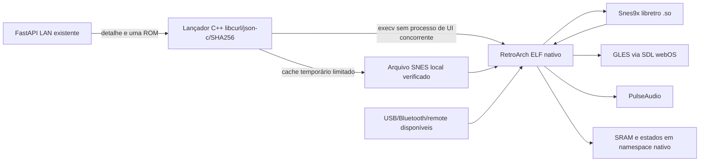

# Arquitetura nativa experimental

**Atualização — produto SNES/PS1:** o código atual usa UI C++ e RetroArch no mesmo
PID por exec, VFS HTTP Range para PS1 e progresso nativo com backup LAN. Veja a
[arquitetura atual e decisões de integração](../development/native-product.md).
As seções abaixo documentam a primeira PoC SNES e seus contratos iniciais.

Data: 18/10/2026. Estado: PoC de P0; produto nativo e aceite físico pendentes.

## Fronteiras e invariantes

O backend não emula. Nenhum JS, iframe, Chromium, WASM ou Flutter participa do
caminho de execução desta PoC. Não há nova camada de input por frame. A operação
LAN termina antes do `execv`; sincronização de saves durante gameplay não está
implementada. O core host completo pertence ao RetroArch e não foi reescrito.

**Confirmado/implementado:** binários ARM32 EABI5 softfp, GLES2/SDL2/PulseAudio
selecionados no config, core dinâmico, manifesto nativo com outro ID,
preparação de ROM e armazenamento isolados. **Testado:** compilação, contratos
LAN simulados, core real no desktop e inicialização na LG com ROM da LAN,
janela visível e stream PulseAudio ativo. **Pendente:** aceite visual, controles,
persistência e desempenho sustentado; ver [sessão física](../hardware/native-tv-session-20261018.md).

## Contrato de preparação

`session.json` é configuração local explícita: `{server, gameId}`. Sem ela, abre
o menu diagnóstico do RetroArch. Parâmetros JSON recebidos do app manager são
validados e ignorados; não escolhem core, URL, caminho ou comando. O diretório
do aplicativo vem de `/proc/self/exe`, não do diretório corrente.

P0 aceita somente origem HTTP com IPv4 literal RFC1918/loopback, porta válida,
sem credenciais/path/query, sem proxy de ambiente e sem redirects. LAN é uma
premissa de rede doméstica confiável, não autenticação ou proteção criptográfica.
O servidor existente não deve ser exposto à Internet. DNS, TLS e descoberta de
servidor não são introduzidos implicitamente.

O detalhe `/api/games/<id>` deve corresponder a SNES/Snes9x, `.sfc/.smc`,
`media.url` exata na mesma origem e tamanho inteiro entre 1 byte e 16 MiB.
O ID contém o SHA-256 integral dos bytes. Download vai para arquivo exclusivo,
limitado durante a transferência, com timeout e verificação do tamanho/hash.
Somente então é admitido por `link`, sem substituir silenciosamente um destino.
Cache corrompido provoca erro e permanece para inspeção; o core não o recebe.

Cache temporário padrão: `/dev/shm/superflipcb-native-<uid>` no tmpfs da LG;
`/tmp` não permite escrita no firmware testado. Um arquivo SNES pronto
é retido; o pico de substituição é 32 MiB mais metadados. Temporários
interrompidos identificáveis são limpos sob lock. Diretórios e arquivos de
controle não seguem links. Um `flock` herdado pelo RetroArch exclui sessões
concorrentes que usam o mesmo cache até o fim do jogo. Esse lock não tenta
coordenar o RetroArch instalado sob outro app ID.

ROMs pequenas são materializadas antes do core. Não existe VFS HTTP genérico,
cache de biblioteca inteira ou mídia óptica em RAM. PS1 requer outro gate de
I/O: Range/seek, cache com orçamento e compatibilidade do core, ou arquivo
completo em armazenamento autorizado. Não se extrapola o limite SNES para ISOs.

## Configuração, saves e lifecycle

ID novo: `com.superflipcb.native.poc`. O legado `com.superflipcb.app` e o
RetroArch instalado pelo usuário não são atualizados/substituídos.

Dados experimentais ficam em `userdata/<core-source-SHA>-<binary-SHA>/<gameId>`
dentro deste aplicativo. SRAM e estados nunca usam `data/saves` do servidor,
nem arquivos de configuração/saves do RetroArch baseline. O SHA do binário
separa estados de builds diferentes; compatibilidade não é inferida de tamanho.
`XDG_CONFIG_HOME` também é separado. Backups externos de qualquer progresso novo
precisam anteceder reinstalação: dados dentro da instalação não têm garantia de
permanecer após remoção/expiração do Developer Mode.

RetroArch possui o ciclo init/load/run/menu/unload/deinit e autosave local a
cada 10 s. Perda de foco pausa pelo mecanismo upstream; Select+Start é o combo
explicitamente escolhido (`INPUT_COMBO_START_SELECT=4` na fonte fixada). Não há
overlay de botão Menu, run-ahead, rewind, shader ou vídeo em thread habilitados.
VSync e audio sync seguem o runtime; latência de 64 ms é configuração inicial,
não medida de latência final. Mudanças de audio buffer serão comparadas na TV.

Persistência local do RetroArch não herda automaticamente as garantias do
SaveStore FastAPI. Não há sync, merge, migração ou recuperação de encerramento
abrupto comprovada nesta PoC. A fase de produto deve distinguir `no-save-memory`
de `save-error`, guardar cópia durável antes de upload, usar um namespace de API
nativo e conservar atomicidade/ETag/backup. Não aceitar upload nativo fingindo
ser `emulatorjs-4.2.3`.

## Integração visual e ownership futuro

A UI atual permanece intacta. RGUI serve somente para a prova técnica; não
representa a identidade visual final. Avaliar um pequeno fluxo real de catálogo
e detalhes com os tokens existentes antes de escolher custom menu/fork ou B.
Separar o tempo de engenharia de UI do custo de CPU/GPU durante o jogo.
O catálogo completo, capas, histórico, associação de jogadores, remapeamento
persistente e interface de saves ainda não foram implementados no novo app.

Não criar subsistemas de vídeo/áudio/input vazios para uma estrutura hipotética.
O runtime upstream é o responsável atual. Se B vencer, a substituição deve
preservar os contratos LAN, IDs e namespaces, mas exigirá uma nova implementação
completa de frontend e gates próprios; não reaproveitar o harness de teste como
core host de produção.
