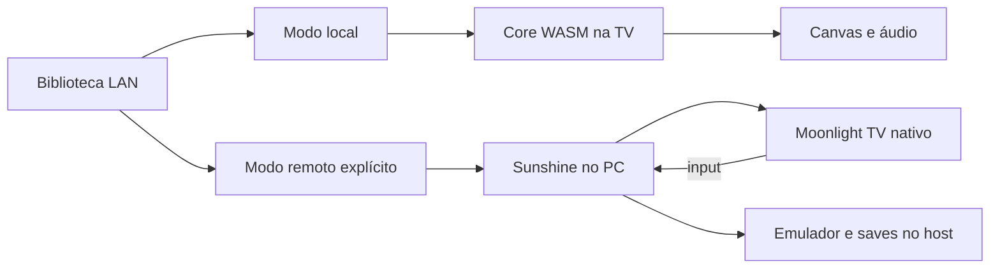

# Arquitetura local + remota

Revisão de 17/10/2026. O FastAPI auditado serve catálogo, ROMs, runtime e saves; **não executa jogos, não codifica vídeo e não recebe um protocolo de input remoto**. Hospedar em outro servidor não acelera um core que continua executando na TV.

## Recomendação

Preservar execução local para sistemas/títulos que cumprirem o orçamento de frame da TV. Oferecer execução remota como modo explícito para títulos que não cumprirem esse orçamento ou para PS1 quando necessário. A escolha deve ficar visível na sessão; não trocar automaticamente de engine ou de origem de saves.

O desenho descreve a recomendação, não uma integração já entregue.

## Alternativas

| Caminho | Latência e recursos | Compatibilidade, segurança e custo |
|---|---|---|
| WASM local | Input/emulação/apresentação locais. Rede necessária no boot e para salvar; sem encode/transporte/decode por frame | Limitado por um core/browser, GL/áudio e memória do web app. Arquitetura existente e menor custo operacional |
| [Sunshine](https://docs.lizardbyte.dev/projects/sunshine/latest/) + [Moonlight TV](https://github.com/mariotaku/moonlight-tv/wiki) | Soma emulação, captura, encode, LAN, decode e apresentação. Decode nativo aproveita hardware da TV, mas latência precisa de medição | Solução madura com pairing e sessão. Moonlight é app nativo separado; não embutir biblioteca incompatível no iframe. Precisa PC ligado, encoder compatível e instalação opt-in |
| WebRTC em cliente web | Pode usar decode por hardware se codec/perfil forem suportados; input por DataChannel, controle de congestionamento próprio do WebRTC | Exige servidor de captura/encode, sinalização, autenticação, contexto seguro e suporte real do webOS. É mais integração que servir um MP4; não foi implementada |
| Novo protocolo próprio | Acrescentaria transporte, confiabilidade, A/V sync, recuperação e input | Rejeitado enquanto solução madura satisfizer requisitos |

Não há medição de encode/decode/latência de rede nesta entrega. Não há promessa de “zero lag” ou “60 FPS streaming”. A capacidade de reprodução 4K da TV não demonstra capacidade do mesmo codec/perfil/caminho em WebRTC. Ethernet versus Wi-Fi e modo de imagem devem ser registrados por ensaio.

## Contratos antes de integrar o modo remoto

1. Sessão identifica host pareado, modo, emulador/core/versão, título e origem do progresso. O FastAPI não deve receber comandos shell arbitrários da TV.
2. Pairing permanece no Sunshine/Moonlight. Não guardar credenciais em URL, logs ou frontend. LAN não equivale a rede confiável por definição; sem port-forward/túnel público.
3. Saves locais da TV e do host ficam em namespaces separados. Migração é export/cópia explícita, com backup e compatibilidade comprovada. Save states não são portáveis por pressuposição.
4. Desconexão pausa/encerra a sessão conforme protocolo e mantém progresso no host; não anunciar salvamento sem confirmação do emulador.
5. Input deve seguir o mapper do cliente maduro e o emulador no host. Não criar um segundo canal concorrente para o mesmo gamepad.

## PoC remota proposta, ainda não instalada

Atualização: o usuário escolheu preparar este PC, mantendo instalação e pareamento pendentes. A GPU/driver foram inventariados somente localmente; NVENC/QuickSync/captura não foram testados. [Inventário e dependências](performance-overhaul-execution.md). Nenhuma regra de firewall, serviço, driver ou instalação foi alterada. Acesso à TV depende de autorização específica.

Emparelhar Sunshine com Moonlight TV; abrir o mesmo título SNES usado no teste local e, depois, um título PS1 legítimo; fixar encoder, codec, resolução, bitrate, FPS e rede. Medir latência input→fóton externamente, quedas, áudio e recuperação. Usar 1080p60 como configuração de teste apenas se ambos os lados aceitarem; comparar 720p e limites sem atribuir o resultado ao painel.

Aceite: três sessões repetíveis, 30 min sem interrupção relevante, controles corretos, saves do host reconhecidos e reabertura após queda. Rollback: encerrar o cliente remoto e voltar ao modo local; nenhum save local é sobrescrito. Instalação/pareamento do software do host/TV e eventual promoção do modo remoto ficam para uma etapa explícita. PS2 não entra nessa PoC nem no plano atual.
