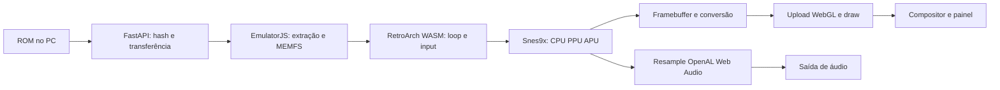

# Investigação de desempenho — LG 55QNED70BSA

17/10/2026. Base auditada: **`a69e2f70bc69aaeb98549b9611e9c6a0abaa2e38`**. Branch: `codex/performance-investigation`. As medições incluem alterações locais; não representam uma release publicada. [Identidades das fontes](data/upstream-inventory-2026-10-17.json), [binários](data/binary-inventory-2026-10-17.json), [assets efetivamente servidos na primeira rodada](data/measured-assets-first-pass-2026-10-17.json) e [hashes da entrega local](data/local-source-manifest-2026-10-17.json).

Continuação local: [execução do overhaul](performance-overhaul-execution.md). O novo shim 2005 permite separar `retro_run`/conversão/callback de áudio no experimento; ainda não atribui os índices WASM do binário histórico. Nenhuma comparação física nova foi concluída. Todo novo acesso/teste na TV exige autorização explícita do usuário para a sessão.

## Conclusão sustentada pelos dados

A lentidão foi reproduzida **na TV física**, com o app visível e sem pausa: Super Mario World produziu **34,454 e 37,367 frames do core/s**, em duas janelas de 30 s após 60 s de aquecimento. O contador mede avanço do core, não apresentação no painel. O cabeçalho da ROM indica região 1 (América do Norte); referência nominal selecionada: 60,0988 Hz. Os resultados equivalem a aproximadamente 57–62% dessa referência e não atendem ao aceite.

O principal custo amostrado está no **WASM que contém RetroArch e Snes9x**, não nos handlers de controle. Uma execução separada com V8 CPU Profiler, janela ~20 s, registrou 705 frames, 35,215 frames/s e:

| Self time amostrado | % do intervalo |
|---|---:|
| Funções WASM | 54,50% |
| Idle | 24,01% |
| `(program)`, sem atribuição mais precisa | 12,83% |
| Outros JS/bindings | 7,65% |
| Garbage collector | 0,64% |
| Scripts bridge/controls | 0,36% |

Fonte: [perfil bruto](data/tv-cpu-profile-2026-10-17.json) e [agregação](data/tv-cpu-summary-2026-10-17.json). O WASM representa ~72% do tempo fora de idle. Seu self time dividido pelos frames é ~15,75 ms/frame **nesta amostragem**, já próximo dos 16,64 ms disponíveis a 60,0988 Hz, antes dos demais custos. Isso não é uma medição isolada de `retro_run`: não atribuir esse número só à CPU emulada. O profiler altera o ensaio; não usamos seu FPS como baseline sem instrumentação.

**Não foram comprovadas três causas independentes de baixo FPS.** Inventá-las a partir da solicitação ocultaria o que ainda falta medir. Os três problemas de maior relevância confirmados são:

1. **Orçamento insuficiente no caminho WASM/frontend serial da TV.** Medido fisicamente e localizado por amostragem. Falta dividir o custo entre core, PPU/APU, conversões, RetroArch e Asyncify para escolher uma mudança de build/core.
2. **Trabalho redundante de input na integração.** Havia timer de 10 ms do EmulatorJS, rAF do iframe, rAF da UI e leituras nativas repetidas na admissão. Foi consolidado sem remapear os botões. A contribuição histórica ao baixo FPS não foi quantificada; no perfil posterior o bridge/controls ocupa só 0,36% do intervalo. Não atribuir a essa correção um ganho de FPS não medido.
3. **Proteção de tela sem integração eficaz no contexto HTTP.** Canvas ativo não é a exceção de vídeo fullscreen documentada pela LG; `navigator.wakeLock` está ausente nessa origem. O glue tentava Wake Lock sem tratar rejeição. É a explicação técnica confirmada para a lacuna de proteção, não uma terceira causa de custo do core. O novo proprietário de proteção e seus limites estão no [relatório da TV](webos-hardware-capabilities.md).

## Pipeline auditado

| Etapa | Evidência / medição / limite |
|---|---|
| Catálogo/ROM no PC | FastAPI serve bytes; não emula nem codifica vídeo. Hash integral e download são trabalho de boot, não executados por frame. Remover essa proteção não resolveria o baixo FPS sustentado |
| Loader/extração/MEMFS | Artefatos locais verificados. Boot é registrado separadamente. WASM/glue descompactados para inspeção, sem alterar os pacotes |
| Frontend + core | Hooks `preMainLoop/postMainLoop` medem iteração inteira; podem incluir Asyncify/yields. Na primeira janela instrumentada A/V ativo, p50 ~9,8–11,6 ms e p95 ~14,9–20,6 ms em subjanela. A cauda ultrapassa o orçamento; o ensaio curto também contém transientes |
| CPU/PPU/APU isoladas | `unavailable`: binário sem símbolos/proveniência completa de compilação; os índices WASM do perfil não identificam essas partes com segurança |
| Framebuffer/cópias | Existe cópia de saída para textura no glue. Não foi quantificado separadamente o tempo de conversão/cópia; não classificado como cópia desnecessária sem comparação |
| WebGL | GL1 confirmado, drawing buffer 1920×1080. Wrappers medem somente CPU de upload/draw, em torno de décimos de ms ou menos por iteração no primeiro ensaio A/V. Não medem fila/GPU/compositor |
| Apresentação | `unavailable`: canvas sem feedback confiável de apresentação. rAF é ritmo de callbacks, nunca FPS visual |
| Áudio | Pacote usa OpenAL/Web Audio. Tempo de `AudioBufferSourceNode.start` é parcial; criação, cópia, resample e consumo ficam fora. Buffer occupancy/underruns não exportados |
| Main thread/pacing | rAF p50 de 16,7 ms com caudas maiores; iteração que perde deadline pode esperar outro tick. Hipótese de interação entre sincronização de áudio, rAF e Asyncify ainda exige tracing/rebuild instrumentado |
| GC | API portátil indisponível no profiler do produto; amostragem CDP encontrou 0,64% nesta janela, insuficiente para responsabilizar GC como causa dominante |
| Memória | Heap WASM 128 MiB; limite virtual 2 GiB não é alocação. JS heap não deve ser somado cegamente ao WASM. Swap e RAM do SO são diferentes do RSS da sessão |

Auditoria integral: `bridge.js`, `controls.js`, `diagnostics.js`, `Player.tsx`, `navigation.ts`, `build-runtime.mjs`, instalador e patch de runtime, `server/app/main.py`, os três relatórios anteriores, fontes geradas, glue e os dois WASM SNES. As fronteiras de saves/ETag, hotkeys, índices físicos e neutro foram preservadas.

## Comparação com RetroArch

O produto **já usa RetroArch** dentro do EmulatorJS. “Trocar para RetroArch” não descreve uma otimização concreta. RetroArch nativo usa outro ambiente: compilação/ABI, drivers, agendamento e, conforme core, SIMD/dynarec nativos. Desempenho excelente em um PC não comprova o mesmo orçamento por frame num ARM da TV, nem identifica o core/configuração da comparação do usuário.

A TV expôs quatro CPUs, parte ARM `0xd09`, clock CPU0 atual/máximo 1,2356 GHz e ~1,67 GiB de memória visível ao SO. A capacidade de IA/4K do processador de imagem não se converte automaticamente em aceleração da CPU/PPU SNES dentro de um WASM serial. Não afirmamos que a TV “não suporta SNES”: falta testar cores/builds mais econômicos no mesmo aparelho.

## Hipóteses abertas, em ordem de utilidade

1. Custo do core atual/Asyncify/frontend e pacing entre áudio/rAF. Exige build com fonte/toolchain/símbolos exatos e timers de `retro_run`, vídeo e áudio separados. Comparar mesma saída e cena.
2. Core mais antigo (2005/2010) ou shim direto reduzir custo suficiente. A alternativa direta passou no desktop, mas depende de contexto seguro para AudioWorklet e não está validada fisicamente no HTTP atual.
3. GL1 versus GL2/resolução de composição; resultados físicos são registrados no [benchmark](benchmark-results.md), sem inferir vencedor por suporte de API.
4. Pressão do SO, aquecimento e carregamento/JIT entre navegações. Uma leitura de 10 s encontrou apenas +3 páginas de swap-in, zero swap-out e +6 major faults no sistema, com PSI baixo naquele instante. Isso não explica sozinho a lentidão nem exclui transientes de memória; [dados](data/tv-memory-pressure-2026-10-17.txt).
5. Latência/underruns reais e cena jogável controlada: precisam ouvido, controle físico e medição externa. O benchmark atual é boot/demo sem input, não uma partida controlada por humano.

## Mudanças entregues e decisão

Profiler opt-in e limitado; input compartilhado em um rAF; UI deixa de consultar gamepad durante gameplay; serialização de diagnóstico limitada; proteção com lifecycle e diagnóstico; botão Menu não permanece visível; matriz isolada sem saves reais; PoC PS1 separada com mídia/BIOS fornecidas pelo operador. Patch 2 verifica fonte, resultado, idempotência e tamper; **nenhum byte de core SNES nem identidade de save foi trocado**.

Castlevania PS1 chegou à tela de título no desktop com BIOS real reconhecida, ~59,90 core/s e roundtrip de bytes do cartão volátil; isso não prova prontidão na TV nem gameplay sustentado. O ensaio físico de inatividade foi interrompido por Home/standby/outro app, conforme confirmação do usuário, e não permite conclusão sobre a eficácia da proteção. Evidências e limites no [benchmark](benchmark-results.md).

Manter baseline e saves atuais, comparar um build/core experimental identificável, e adotar somente com ganho físico e compatibilidade provados. Para títulos que continuarem abaixo do aceite, usar o caminho maduro Sunshine + Moonlight TV como modo remoto explícito. A integração remota ainda não foi instalada. PS2 está fora do planejamento atual. [Plano verificável](../planning/performance-overhaul.md).
