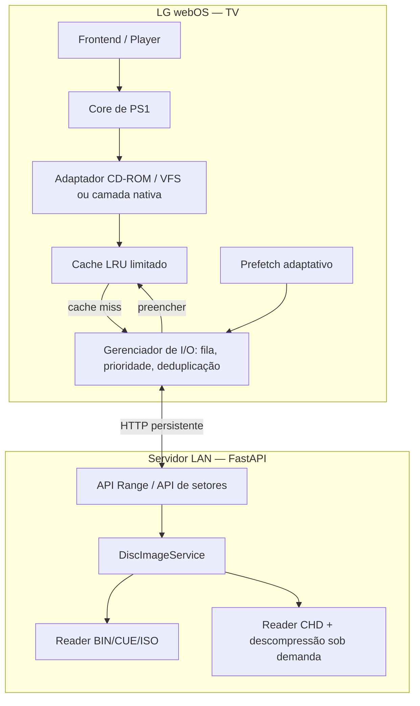

# Super Flip CB — Arquitetura de leitura de discos de PlayStation 1 pela LAN

**Documento:** orientação técnica e plano de implementação  
**Data:** 18/10/2026  
**Aplicação:** Smart TVs LG com webOS; emulação PS1 executada localmente na TV; imagens de disco armazenadas em servidor na rede local  
**Stack de referência:** frontend React/TypeScript, runtime webOS/WebAssembly e/ou prova de conceito nativa; backend Python/FastAPI  
**Status:** proposta arquitetural. Os parâmetros devem ser validados na TV real; não representam uma implementação já existente ou homologada.

---

## 1. Resumo executivo

O PlayStation 1 utiliza um CD-ROM com padrões de leitura sequenciais **e aleatórios**, por vezes em trilhas diferentes. Um jogo pode exigir um setor distante do último acesso, reproduzir áudio CD-DA, ler dados XA e mudar frequentemente de região do disco. Por isso, **não é adequado replicar o modelo de SNES**, que frequentemente carrega uma ROM relativamente pequena para a memória.

A solução recomendada consiste em um **dispositivo de CD-ROM virtual com leitura sob demanda**, usando:

1. **HTTP Range** para arquivos BIN/ISO na etapa inicial, evitando download integral.
2. **Cache LRU limitado por memória**, organizado em blocos de bytes ou setores.
3. **Prefetch adaptativo**, antecipando leituras sequenciais sem desperdiçar recursos durante buscas aleatórias.
4. **Fila de I/O assíncrona** com prioridades, deduplicação de requisições e cancelamento de prefetch obsoleto.
5. **Abstração de disco por LBA** para integrar o sistema ao core do emulador.
6. **Serviço de setores no backend** para formatos como CHD, com descompressão sob demanda no servidor.
7. **Instrumentação**, para separar gargalos de rede, leitura de disco, emulação, vídeo e áudio.

**Princípio central:** a ROM/CD fica no servidor, a **emulação permanece na TV**, e somente os dados necessários atravessam a LAN. Não é necessário carregar um CD completo na RAM nem montar SMB/NFS dentro do webOS.

> Importante: operações assíncronas na infraestrutura de rede não significam que um core síncrono possa continuar emulando sem o setor necessário. Um *cache miss* crítico exige uma espera controlada ou uma integração que permita suspender/retomar a operação de leitura. A interface da TV e a gestão de I/O não devem ficar bloqueadas.

## 2. Objetivos, requisitos e limites

### Objetivos funcionais

- Iniciar um jogo de PS1 hospedado em servidor local sem baixar sua imagem integral.
- Suportar leitura sequencial e aleatória, inclusive mudanças frequentes de LBA.
- Interpretar corretamente trilhas de dados, índices, pregaps e áudio CD-DA/XA quando existirem.
- Preservar a possibilidade de troca de disco para jogos multidisco.
- Tratar interrupções e recuperação de rede com erros explícitos e sem corromper saves.
- Manter o caminho de SNES independente, evitando regressões no sistema atual.

### Objetivos não funcionais

- Memória de cache **estritamente limitada** e configurável.
- Requisições por **bloco**, não por setor individual.
- Comunicação persistente, com baixa latência e sem dependência de nuvem.
- Sem bloqueio do thread de renderização do frontend durante HTTP.
- Capacidade de medir hit rate, tempo de leitura, latências e pausas da emulação.
- Segurança mínima, mesmo em uma rede local.

### Fora do escopo desta etapa

- Streaming de vídeo gerado por um emulador rodando no servidor (*remote play*).
- Emulação de PS2; o modelo de disco óptico, formato e requisitos são diferentes.
- Otimização de CPU/GPU do core, JIT/dynarec e renderização, que precisam de investigação separada.
- Download automatizado de conteúdo protegido por direitos autorais.

## 3. Por que o cache de SNES não deve ser reutilizado sem mudanças

| Aspecto | SNES | PlayStation 1 |
|---|---|---|
| Mídia | Cartucho/ROM | CD-ROM óptico |
| Padrão de acesso | Frequentemente memória mapeada / leitura local | Leitura por setores, sequencial e aleatória |
| Dados carregados | ROM frequentemente inteira | Setores sob demanda |
| Estrutura de mídia | Em geral arquivo de ROM | Trilhas, índices, pregaps, dados e áudio |
| Volume típico | Menor | Centenas de MB, dependendo do jogo |
| Estratégia | Buffer local simples pode bastar | Cache limitado, prefetch e interpretação de CD |

Além do tamanho, a **semântica** difere: um disco não é apenas uma sequência de bytes. A unidade virtual precisa conservar a organização lógica do CD.

## 4. Arquitetura proposta



### Responsabilidades

**Na televisão**

- Core e CPU/GPU emulados.
- Gerenciamento do ciclo do jogo e dos saves.
- Cache em RAM com limite rígido, política LRU e blocos fixos.
- Detecção de sequências, priorização de leituras e redução de prefetch.
- Adaptador entre chamadas do core e serviço remoto.

**No servidor**

- Descoberta e indexação de jogos e trilhas.
- Interpretação de CUE, TOC, CD-DA/XA e formatos suportados.
- Acesso randômico eficiente a arquivos sem carregá-los integralmente.
- Descompressão de CHD por hunks, quando habilitada.
- Exposição dos metadados do disco e dos intervalos solicitados.
- Logs operacionais e controle de acesso.

## 5. Transporte — HTTP Range para o MVP

HTTP Range solicita bytes específicos de um recurso, com resposta `206 Partial Content`. É uma solução simples para BIN/ISO, desde que cada arquivo seja endereçado corretamente.

### Exemplo

```http
HEAD /api/discs/disc-001/files/track-01 HTTP/1.1
```

Resposta esperada para arquivo existente:

```http
HTTP/1.1 200 OK
Accept-Ranges: bytes
Content-Length: 734003200
ETag: "versao-estavel-do-arquivo"
```

Requisição parcial ilustrativa:

```http
GET /api/discs/disc-001/files/track-01 HTTP/1.1
Range: bytes=10485760-10616831
```

Resposta:

```http
HTTP/1.1 206 Partial Content
Content-Range: bytes 10485760-10616831/734003200
Content-Length: 131072
Accept-Ranges: bytes
```

O intervalo é **inclusivo** e totaliza 128 KiB. Os números acima são ilustrativos.

### Regras do cliente

1. Validar `status === 206` quando uma leitura parcial foi solicitada.
2. Conferir `Content-Range`, tamanho efetivo e versão do disco (`ETag`/identificador do catálogo).
3. Se o servidor responder `200` com o arquivo completo, **não** converter automaticamente a resposta em download do CD inteiro: interromper e sinalizar servidor incompatível.
4. Tratar `416` como intervalo inválido ou mudança no arquivo, invalidando o cache quando apropriado.
5. Reutilizar conexões persistentes; limitar concorrência para não sobrecarregar o navegador.
6. Na mudança de versão/ETag, limpar blocos antigos e reabrir o disco com metadados novos.
7. Usar `Cache-Control` apropriado e evitar que caches intermediários sirvam blocos de versões diferentes.
8. Para origens diferentes, configurar CORS e os cabeçalhos acessíveis (`Content-Range`, `ETag`, etc.).

### Exemplo inicial no FastAPI

```python
from pathlib import Path
from fastapi import FastAPI, HTTPException
from fastapi.responses import FileResponse

app = FastAPI()

# A aplicação real mantém um catálogo de IDs -> arquivos aprovados.
DISC_FILES: dict[tuple[str, str], Path] = {
    ("disc-001", "track-01"): Path("/srv/roms/ps1/game-track01.bin")
}

@app.api_route(
    "/api/discs/{disc_id}/files/{file_id}",
    methods=["GET", "HEAD"],
)
def read_disc_file(disc_id: str, file_id: str):
    path = DISC_FILES.get((disc_id, file_id))
    if path is None or not path.is_file():
        raise HTTPException(status_code=404, detail="Arquivo não encontrado")

    # Starlette FileResponse suporta Range/206 e HEAD nas versões atuais.
    return FileResponse(path, media_type="application/octet-stream")
```

**Limites do exemplo:** faltam autenticação, versão estável do catálogo, tratamento de alteração simultânea do arquivo, observabilidade e testes contra a versão exata de Starlette adotada. Jamais permitir que um caminho fornecido pelo cliente seja concatenado livremente ao diretório de ROMs.

## 6. Modelo de setores e endereçamento

### Noções importantes

- **LBA** (*Logical Block Address*): posição lógica de um setor.
- **MSF**: endereçamento minuto:segundo:quadro usado em CDs.
- **Setor bruto de CD**: tipicamente 2.352 bytes; o conteúdo e sua interpretação variam conforme o modo da trilha.
- **Payload Mode 1**: comumente 2.048 bytes de dados úteis por setor, mas **não** equivale a todos os setores do CD.
- **Mode 2/XA**: setores têm campos e disposição específicos; podem carregar áudio e dados intercalados.
- **CD-DA**: áudio digital em setores de trilhas de áudio.
- **CUE/TOC**: descrevem arquivos, trilhas, índices, modos e posições.

A tradução LBA ↔ arquivo/offset depende da estrutura da imagem, de seus `INDEX 00`/`INDEX 01`, pregaps, arquivos múltiplos e convenção de endereçamento do core. **Não é válido universalizar `offset = LBA * 2352`.** Essa fórmula somente funciona em um caso restrito, com trilha contínua, setores brutos fixos e base de endereçamento corretamente ajustada.

### API lógica sugerida

```typescript
interface DiscMetadata {
  discId: string;
  version: string;
  sectorAddressing: "disc-lba";
  firstLba: number;
  leadOutLba: number;
  tracks: Array<{
    number: number;
    type: "MODE1" | "MODE2_XA" | "AUDIO";
    startLba: number;
    endLbaExclusive: number;
    index0Lba?: number;
    index1Lba: number;
  }>;
}

interface SectorReadOptions {
  signal?: AbortSignal;
  priority?: "critical" | "prefetch";
}

interface DiscReader {
  open(discId: string): Promise<DiscMetadata>;
  readSectors(
    lba: number,
    count: number,
    options?: SectorReadOptions
  ): Promise<Uint8Array>;
  prefetch(lba: number, count: number): void;
  close(): Promise<void>;
}
```

Esse contrato é uma **abstração de transporte**, não substitui automaticamente a API do core: o adaptador precisará expor tamanho e composição corretos dos setores, TOC, comportamento de seek e informações exigidas pelo CD-ROM emulado. Quando forem necessários dados de subcanal, incluir um contrato próprio e validar sua disponibilidade na imagem.

## 7. Cache LRU na TV

### Valores de partida — sujeitos a benchmark

| Item | Valor inicial | Observações |
|---|---:|---|
| Bloco de cache HTTP | 128 KiB | Independente do tamanho físico de setor |
| Cache total | 16–32 MiB | Tentar 16 MiB em TVs mais restritas |
| Entradas com 32 MiB | 256 blocos | 32 MiB ÷ 128 KiB |
| Prefetch sequencial | 512 KiB a 2 MiB | Ajustável conforme hit rate e seeks |
| Downloads concorrentes | 2–4 | Separar críticos de especulativos |
| Requisições por setor | 0 | Um bloco atende múltiplos setores |
| Política de expulsão | LRU com pin de blocos ativos | Proteger em uso e leituras críticas |

O limite real deve somar **cache + buffers em trânsito + buffers do core + heap WebAssembly + overhead de JS**, evitando que 32 MiB de cache se transformem em múltiplas cópias e esgotem a memória do navegador.

### Chaves de cache

Para `Range`: `(discId, version, fileId, blockIndex)`.

Para API de setores: `(discId, version, logicalBlockIndex, representation)`.

`representation` distingue, por exemplo, setores brutos, payload e subcanal. Não misturar dados de representações diferentes na mesma chave.

### Fluxo de leitura

```text
core solicita LBA ou intervalo
  -> adaptador converte para arquivo/offset ou blocos lógicos
  -> cache possui todos os blocos?
       -> sim: retorna os bytes solicitados
       -> não: enfileira blocos ausentes como CRITICAL
              -> deduplica solicitações idênticas em andamento
              -> aguarda apenas os dados indispensáveis
              -> valida tamanho, versão e integridade da resposta
              -> insere no cache, com eviction se necessário
              -> retorna dados ao adaptador
  -> prefetch em background para leituras plausíveis
```

### Invariantes

- Cache estritamente limitado, com política para blocos em uso e requisições em andamento.
- Nunca expulsar bytes aos quais o core ainda mantém uma referência válida.
- Cancelar/repriorizar **prefetch**, não cancelar arbitrariamente uma leitura crítica.
- Compartilhar a mesma Promise/solicitação para misses simultâneos do mesmo bloco.
- Não compartilhar cache entre versões diferentes da imagem.
- Evitar cópias desnecessárias entre Worker, thread do core e heap WASM.

## 8. Prefetch adaptativo

Prefetch sequencial é adequado quando o jogo lê regiões contíguas. No entanto, PS1 também realiza *seeks* grandes: continuar buscando a região anterior depois de um salto prejudica o desempenho.

### Heurística inicial

1. Acompanhar os últimos acessos: LBA inicial, contagem de setores, horário e distância ao acesso anterior.
2. Se vários acessos consecutivos avançam para regiões adjacentes, aumentar gradualmente a janela de prefetch (até o teto configurado).
3. Se houver salto grande para uma nova região, reduzir a janela especulativa, cancelar as tarefas não iniciadas e priorizar os blocos críticos do novo destino.
4. Em leituras pequenas e erráticas, usar janela mínima ou suspender o prefetch.
5. Quando o cache estiver sob pressão ou o áudio atrasar, reduzir a especulação.
6. Evitar prefetch além do limite lógico do disco ou cruzando trilhas sem confirmação do adaptador.

### Filas com prioridade

```text
P0 CRITICAL: bloco necessário agora ao core/CD-ROM
P1 REALTIME: continuidade de leitura de áudio/dados XA
P2 PREFETCH: blocos prováveis no futuro próximo
```

A priorização deve evitar starvation e preservar a cadência do áudio. Um leitor de áudio CD-DA/XA pode precisar de buffer separado/controle de jitter, dependendo do desenho do core.

### Cancelamento

- Cancelar primeiro **tarefas ainda na fila**.
- Usar `AbortController` somente quando efetivamente economizar rede e não interromper dados compartilhados por outra solicitação.
- Não descartar um bloco já validado que ainda seja útil ao cache.

## 9. Formatos de imagem

| Formato | MVP | Arquitetura definitiva | Observações |
|---|---|---|---|
| BIN/CUE | Sim | Sim | CUE define trilhas e índices; BIN pode conter dados brutos e áudio |
| ISO | Opcional | Opcional | Compatibilidade limitada dependendo de setor/estrutura do disco |
| CHD | Não obrigatório | Recomendado | Leitura/descompressão por hunk no servidor |
| CCD/IMG/SUB | Futuro | Conforme necessidade | Metadados/subcanal demandam tratamento apropriado |
| ZIP/7z | Não | Evitar como formato de execução | Não depender de descompactar o CD completo na TV |

### BIN/CUE

Começar com um parser que resolva pelo menos:

- `FILE`, múltiplos arquivos e nomes relativos ao diretório do CUE.
- `TRACK`, modos de trilha e `INDEX 00`/`INDEX 01`.
- `PREGAP` e `POSTGAP`, quando presentes.
- Intervalos de dados e áudio, tamanho de setor e layout físico.
- Validação de limites, arquivos faltantes e caminhos inválidos.

A imagem deve ser exposta por um **manifesto lógico**, evitando que o navegador precise interpretar livremente caminhos enviados pelo arquivo CUE.

### CHD

CHD utiliza unidades compactadas chamadas *hunks*. Em um arquivo CHD, a posição física dos bytes não corresponde diretamente ao LBA. O servidor deve empregar um leitor compatível, por exemplo `libchdr`, para:

1. Abrir o CHD e ler seus metadados.
2. Associar os setores e trilhas ao layout lógico do disco.
3. Identificar hunks necessários à faixa solicitada.
4. Ler/descomprimir apenas os hunks pertinentes.
5. Opcionalmente manter um pequeno cache de hunks **no servidor**.
6. Produzir uma resposta de setores no formato acordado com o adaptador da TV.

**Não executar** conversão CHD → BIN integral no momento de iniciar cada jogo; isso apenas deslocaria o gargalo. Também não usar rotinas de `precache` de arquivo inteiro se o requisito for streaming sob demanda.

O MAME documenta que hunks grandes podem reduzir a eficiência de leituras pequenas e aleatórias, pois um hunk completo precisa ser descomprimido. A escolha do tamanho do hunk é uma decisão de preparação da imagem e não deve ser presumida para todos os arquivos existentes.

## 10. API definitiva de CD-ROM virtual

### Endpoints sugeridos

| Método | Endpoint | Finalidade |
|---|---|---|
| `GET` | `/api/discs/{id}/manifest` | Descrever versão, trilhas, LBA, formato e capacidades |
| `GET`/`HEAD` | `/api/discs/{id}/files/{fileId}` | Range em arquivo físico BIN/ISO |
| `GET` | `/api/discs/{id}/sectors?lba=N&count=C` | Setores lógicos consecutivos em representação definida |
| `GET` | `/api/discs/{id}/toc` | TOC normalizada, quando não incluída no manifesto |
| `GET` | `/api/discs/{id}/health` | Verificar mídia acessível e versão da imagem |

### Exemplo de manifesto

```json
{
  "discId": "ps1-demo-disc-1",
  "version": "sha256-do-manifesto-ou-id-de-versao",
  "format": "BIN_CUE",
  "sectorAddressing": "disc-lba",
  "sectorRepresentation": "raw2352",
  "firstLba": 0,
  "leadOutLba": 300000,
  "tracks": [
    {
      "number": 1,
      "type": "MODE2_XA",
      "startLba": 0,
      "index1Lba": 0,
      "endLbaExclusive": 300000
    }
  ],
  "capabilities": {
    "httpRange": true,
    "logicalSectorReads": true,
    "cdDa": true,
    "xa": true,
    "subchannel": false
  }
}
```

*Exemplo exclusivamente estrutural: os valores, a representação de setores e as capacidades precisam ser gerados a partir do disco real. `cdDa: true` não significa que toda imagem possua trilhas de áudio.*

### API de setores

```http
GET /api/discs/ps1-demo-disc-1/sectors?lba=15000&count=64 HTTP/1.1
```

O servidor devolve, por exemplo, `64 × 2352 = 150528` bytes **somente se** o contrato acordado for `raw2352` e todos os setores da faixa puderem ser representados dessa maneira. Caso contrário, devolver erro explícito ou trabalhar com envelopes tipados, sem pressupor que todos os formatos têm a mesma representação física.

Obrigatório nesse endpoint:

- Definir representação e convenção de LBA sem ambiguidades.
- Impor limite máximo para `count` por requisição.
- Validar a faixa solicitada e seus limites.
- Incluir versão/identificador de disco nos cabeçalhos.
- Evitar respostas parciais silenciosas que o cliente interprete como completas.
- Não confundir `206 HTTP Range` com um endpoint de setores: ambos podem ser usados, mas são contratos diferentes.

## 11. Integração com o core de PS1

### O ponto crítico: contrato síncrono versus rede assíncrona

Emuladores legados com frequência assumem acesso síncrono, por exemplo:

```c
fseek(file, offset, SEEK_SET);
fread(buffer, 1, length, file);
```

Já `fetch()` no navegador é assíncrono. **Não é seguro** substituir um `fread()` síncrono por `fetch()` e presumir que o core aguardará sua conclusão automaticamente.

### Caso A — webOS nativo

No runtime nativo, implementar `DiscReader` atrás de uma interface compatível com as operações esperadas pelo core:

- Thread de I/O e cache independentes.
- Condição/espera bloqueante somente **na thread de emulação**, quando a leitura for realmente indispensável.
- Interface e controle não bloqueados.
- Operações `open`, `read`, `seek`, `tell`, `close` e controle do disco suportadas conforme uso real do core.
- Prevenção de deadlocks e sinalização de erro de rede.

Esse caminho costuma oferecer controle mais previsível do bloqueio e do agendamento, mas sua viabilidade depende do SDK, bibliotecas, APIs disponíveis e das permissões efetivas do webOS na TV-alvo.

### Caso B — WebAssembly + frontend web

Avaliar, em ordem:

1. **Worker que hospeda o core** e integração explícita com uma ponte de leitura/retomada, se o core suportar uma adaptação desse tipo.
2. **Emscripten com pthreads e SharedArrayBuffer**, se a versão específica do browser webOS, a compilação do core e os cabeçalhos de isolamento permitirem. Nesse arranjo é possível coordenar um núcleo de emulação que espera enquanto outro contexto resolve I/O. Nunca usar `Atomics.wait` no thread principal da interface.
3. **Camada de sistema de arquivos virtual (VFS)** ou adaptador de `fopen`/`fread`/`fseek`, mas apenas após confirmar onde o core realmente acessa o disco e quais operações ele usa.
4. Se nenhuma integração for viável sem bloqueio excessivo, considerar a versão **nativa** como rota preferida para PS1.

`Worker` comum **não** torna automaticamente síncrono um `fetch`. Também não pressupor suporte a `SharedArrayBuffer` sem medição no aparelho real.

### Atenção específica ao PCSX ReARMed

O manifesto do core Libretro `PCSX ReARMed` declara **`needs_fullpath = true`**, isto é, espera um caminho de conteúdo compatível; o frontend não pode tratá-lo como um core que sempre aceita receber toda a ROM em `retro_game_info.data`.

Opções de implementação:

- Expor um **caminho virtual** e implementar a camada de arquivo que o core utiliza de fato.
- Aproveitar a interface Libretro VFS **somente após comprovar que essa build do core percorre essa interface para o caminho de disco**; não assumir suporte universal.
- Instrumentar/alterar a camada de CD-ROM do core, preservando sua API interna.
- Usar outra build/variante cujo acesso ao disco seja mais simples de adaptar, desde que validada funcionalmente e com licença compatível.

Não basta anunciar um arquivo remoto por URL no campo de caminho se o core vai chamar `fopen()` em um arquivo de sistema local.

### Troca de discos e memória de gravação

- A troca de CD deve invalidar a versão do disco e, quando necessário, o cache.
- Preservar save states e memory cards separadamente da camada de ROMs.
- Não confundir **SRAM de cartucho SNES** com **memory cards de PS1**.
- Testar controle de disco da interface Libretro para títulos multidisco.

## 12. Pseudocódigo do cache e do leitor

O exemplo a seguir descreve a lógica do cliente, não um adaptador pronto para `fread()` síncrono:

```typescript
const BLOCK_SIZE = 128 * 1024;
const MAX_CACHE_BYTES = 32 * 1024 * 1024;

type Key = string;

class RangeBlockReader {
  private cache = new Map<Key, Uint8Array>();
  private inFlight = new Map<Key, Promise<Uint8Array>>();
  private cachedBytes = 0;

  constructor(
    private readonly url: string,
    private readonly discVersion: string,
    private readonly fileId: string,
    private readonly fileSize: number,
  ) {}

  private key(index: number): Key {
    return `${this.discVersion}:${this.fileId}:${index}`;
  }

  private async fetchBlock(index: number): Promise<Uint8Array> {
    const start = index * BLOCK_SIZE;
    if (start >= this.fileSize || start < 0) {
      throw new RangeError("Bloco fora do arquivo");
    }
    const end = Math.min(start + BLOCK_SIZE, this.fileSize) - 1;
    const response = await fetch(this.url, {
      headers: { Range: `bytes=${start}-${end}` },
      cache: "no-store",
    });

    if (response.status !== 206) {
      throw new Error(`Range não atendido: HTTP ${response.status}`);
    }

    const expected = `bytes ${start}-${end}/${this.fileSize}`;
    if (response.headers.get("Content-Range") !== expected) {
      throw new Error("Content-Range inválido ou arquivo alterado");
    }

    const bytes = new Uint8Array(await response.arrayBuffer());
    if (bytes.byteLength !== end - start + 1) {
      throw new Error("Resposta parcial truncada");
    }
    return bytes;
  }

  private remember(key: Key, value: Uint8Array): void {
    const previous = this.cache.get(key);
    if (previous) this.cachedBytes -= previous.byteLength;
    this.cache.delete(key);
    this.cache.set(key, value);
    this.cachedBytes += value.byteLength;

    // Map mantém ordem de inserção; reinserir no hit atualiza LRU.
    while (this.cachedBytes > MAX_CACHE_BYTES) {
      const oldest = this.cache.keys().next().value;
      if (oldest === undefined) break;
      const evicted = this.cache.get(oldest)!;
      this.cache.delete(oldest);
      this.cachedBytes -= evicted.byteLength;
    }
  }

  async block(index: number): Promise<Uint8Array> {
    const key = this.key(index);
    const hit = this.cache.get(key);
    if (hit) {
      this.cache.delete(key);
      this.cache.set(key, hit);
      return hit;
    }

    const pending = this.inFlight.get(key);
    if (pending) return pending;

    const promise = this.fetchBlock(index).then((bytes) => {
      this.remember(key, bytes);
      return bytes;
    });
    this.inFlight.set(key, promise);
    try {
      return await promise;
    } finally {
      this.inFlight.delete(key);
    }
  }
}
```

**Atenção ao exemplo:** demonstra apenas fetch, validação básica, deduplicação e LRU. Para produção, ainda precisa de:

- Orquestração da concorrência e filas de prioridade.
- Cancelamento e retry com backoff limitado.
- `AbortSignal`, timeout, fechamento do leitor e invalidação do cache.
- Garantia de versionamento/ETag consistente entre manifesto e transferência.
- Coalescência de blocos adjacentes em uma requisição quando viável.
- Leitura de intervalos atravessando vários blocos.
- Proteção de blocos utilizados pelo core e contagem correta de buffers em trânsito.
- Integração de setores, trilhas e formatos, que não aparece nesse exemplo.
- Adaptação explícita para a chamada síncrona ou suspendível do core.

É **pseudocódigo operacional de um componente**, não solução completa de emulação de PS1.

## 13. Falhas, recuperação e consistência

| Falha | Comportamento esperado |
|---|---|
| Servidor indisponível ao iniciar | Exibir erro recuperável; não tentar baixar arquivo inteiro |
| Timeout em leitura crítica | Retry limitado + suspensão segura da emulação quando necessário |
| Timeout em prefetch | Abandonar especulação; priorizar o que for crítico |
| Mudança de IP ou queda da LAN | Revalidar servidor e versão do disco; retomar somente quando seguro |
| Resposta HTTP `200` a `Range` | Erro de protocolo; não consumir CD inteiro |
| Resposta truncada | Não inserir bloco em cache; tentar novamente conforme política |
| Arquivo alterado durante execução | Invalidar cache, abortar leitura incompatível e exigir reabertura |
| Troca de disco | Reabrir manifesto e isolar caches por `discId`/versão |
| CUE inválido ou arquivo ausente | Rejeitar o disco no catálogo com diagnóstico objetivo |
| Memória acima do limite | Reduzir prefetch/cache; nunca permitir crescimento descontrolado |

**Proteção de dados:** saves não devem depender do sucesso da leitura de CD nem ser sobrescritos por erro de rede. Salvar memcards de maneira atômica, conforme a implementação existente.

## 14. Segurança e rede local

- Manter IDs de arquivos opacos, resolvidos exclusivamente pelo catálogo do servidor; impedir *path traversal*.
- Vincular o serviço à interface LAN necessária, não expô-lo indiscriminadamente à Internet.
- Usar token pareado ou autenticação compatível com o produto; não presumir que a LAN é confiável.
- Restringir CORS à origem do frontend quando possível; expor cabeçalhos exigidos pelo cliente.
- Aplicar limites de tamanho e contagem às requisições de setores.
- Validar formatos e metadados antes de abrir arquivos potencialmente malformados.
- Manter bibliotecas de parsing/descompressão atualizadas e testar arquivos malformados.
- Considerar HTTPS quando viável; em browser, verificar compatibilidade de *mixed content*, políticas de origem e isolamento na TV real.

## 15. Observabilidade e métricas

| Indicador | O que responde |
|---|---|
| `cache_hit_ratio` | Quantas leituras foram atendidas localmente? |
| `cache_bytes` | A memória respeita o teto? |
| `disc_read_latency_ms_p50/p95/p99` | Qual a distribuição das esperas por dados? |
| `http_request_count` | Quantas requisições por segundo/minuto? |
| `http_bytes_received` | Qual o tráfego real, inclusive prefetch inútil? |
| `prefetch_usefulness_ratio` | O que foi antecipado chegou a ser consumido? |
| `critical_wait_duration_ms` | Quanto tempo o core ficou parado por dados? |
| `inflight_requests` | Há saturação ou fila excessiva? |
| `disc_seek_distance_lba` | As leituras são contíguas ou dispersas? |
| `audio_underrun_count` | O áudio está ficando sem dados? |
| `frame_time_ms` / FPS | O gargalo é I/O ou processamento gráfico/CPU? |
| `read_error_count` / retries | Quais falhas de LAN ou mídia ocorreram? |

A taxa contínua de CD-ROM 2× é pequena para uma LAN atual: **75 setores/s × 2 × 2.352 bytes = 352.800 B/s ≈ 344,5 KiB/s** de bytes brutos, desconsiderando overhead e picos de pré-busca. Portanto, a principal dificuldade tende a ser **latência, quantidade de requisições, organização de dados e bloqueios**, não a largura de banda sustentada. Isso não garante, por si só, que a rede será o gargalo em todos os jogos.

## 16. Plano de implementação incremental

### Fase 0 — Diagnóstico antes de otimizar

- [ ] Identificar a build e o core PS1 adotado (nativo ou WASM).
- [ ] Inspecionar o caminho exato de leitura de CD no core: `fopen`, VFS, callbacks internos ou outro.
- [ ] Verificar se o core suporta `needs_fullpath`, múltiplas trilhas e troca de disco.
- [ ] Medir RAM disponível, thread principal, latência da LAN e tempo de abertura de um arquivo de referência.
- [ ] Testar HTTP Range, `HEAD`, `Content-Range` e CORS no navegador/runtime da TV.
- [ ] Confirmar `SharedArrayBuffer`, COOP/COEP e pthreads **na TV real** caso o caminho WASM dependa deles.

**Saída:** mapa de integração do core e baseline mensurável.

### Fase 1 — MVP BIN/CUE + Range

- [ ] Implementar catálogo de arquivos e endpoint HTTP Range.
- [ ] Interpretar CUE e mapear trilhas/índices para arquivos aprovados.
- [ ] Criar manifesto versionado por disco.
- [ ] Implementar cache LRU de 16 MiB inicialmente e blocos de 128 KiB.
- [ ] Adicionar fila crítica, deduplicação e prefetch sequencial conservador.
- [ ] Conectar o leitor ao caminho **real** de acesso a CD do core.
- [ ] Criar testes com discos de dados simples e BIN/CUE multitrilha.

**Saída:** jogo inicia sem download integral e solicita blocos de forma verificável.

### Fase 2 — Disco virtual lógico no servidor

- [ ] Criar interface `DiscImageService` e `SectorReader` no backend.
- [ ] Implementar `/manifest`, `/toc` e `/sectors`.
- [ ] Unificar leitura de setores de diferentes arquivos de trilha.
- [ ] Testar CD-DA, XA, pregaps, lead-out, setores brutos e limites.
- [ ] Incluir suporte a CHD com `libchdr` ou biblioteca equivalente.
- [ ] Adicionar cache de hunks com limite no servidor.

**Saída:** cliente desacoplado do formato físico da imagem.

### Fase 3 — Otimização adaptativa e estabilidade

- [ ] Ajustar cache 16/32 MiB e blocos 64/128/256 KiB por métricas reais.
- [ ] Introduzir prefetch adaptativo a seeks e pressão de memória.
- [ ] Priorizar continuidade de áudio quando necessária.
- [ ] Testar perda de conexão, latência injetada e falhas de leitura.
- [ ] Instrumentar FPS, frame time e esperas críticas por disco.
- [ ] Validar saves/memory cards e troca de CD.

**Saída:** perfis medidos, fallback seguro e desempenho previsível nos jogos de teste.

## 17. Matriz de testes de aceitação

| Cenário | Verificação |
|---|---|
| Imagem BIN/CUE grande | Inicia sem solicitar o arquivo inteiro |
| Leituras repetidas do mesmo LBA | Cache hit; não duplicar requisição |
| Leituras adjacentes | Prefetch melhora o fluxo e usa blocos maiores |
| Salto aleatório grande | Repriorização rápida; prefetch anterior não monopoliza rede |
| Jogo com CD-DA | Música correta, sem troca indevida de trilha |
| Jogo com XA | Áudio/dados XA sem perda de formato |
| Jogo multitrilha | Mapeamento conforme CUE e TOC |
| Jogo multidisco | Troca efetiva sem mistura de cache |
| CHD | Mesmo comportamento lógico da versão BIN/CUE de referência |
| HTTP `200` em vez de `206` | Falha segura, sem download completo |
| Timeout/perda de Wi-Fi | Erro ou pausa recuperável; interface permanece responsiva |
| Arquivo alterado | Versão antiga invalidada; nenhuma mistura de setores |
| Uso prolongado | RAM estabiliza dentro do orçamento total |
| Salvar/carregar | Saves e memory cards íntegros |
| Retrocompatibilidade SNES | Nenhuma regressão no player anterior |

### Critérios de conclusão

A etapa poderá ser considerada concluída quando:

1. O jogo PS1 carregar via LAN sem download integral da imagem.
2. O cache respeitar o teto configurado, incluindo comportamento estável após uso prolongado.
3. Não ocorrer uma requisição HTTP para cada setor em um fluxo normal.
4. Leitura aleatória, trilhas e áudio forem corretos para a matriz de jogos validada.
5. A UI da TV continuar responsiva durante leitura ou perda de rede.
6. As esperas por I/O forem registradas e distintas de gargalos do core.
7. Regressões em SNES e saves forem descartadas por testes.

**Não estabelecer FPS mínimo universal sem identificar o hardware da TV, o core e o jogo.** Quando um jogo continuar lento mesmo com quase todos os acessos ao disco em cache, direcionar investigação para CPU, recompilação dinâmica, vídeo, áudio, threads e renderização.

## 18. Decisões recomendadas

| Decisão | Recomendação | Justificativa |
|---|---|---|
| Rodar emulação onde? | TV, se o desempenho do core permitir | Independência de servidor de processamento |
| Arquivos armazenados onde? | Servidor LAN | Poupa armazenamento local |
| Como ler BIN no MVP? | HTTP Range | Simplicidade e leitura parcial nativa |
| Como ler CHD? | Descompressão no servidor | Reduz complexidade do cliente |
| Cache na TV? | LRU limitado, 16–32 MiB inicialmente | Equilíbrio entre memória e misses |
| Prefetch? | Adaptativo, prioritariamente sequencial | Evita desperdício em seeks aleatórios |
| Conexão? | HTTP persistente + limites de concorrência | Menor custo operacional |
| Interface do core? | Confirmar na build real antes de implementar | Evita erro com VFS/`needs_fullpath` |
| Montar SMB/NFS na TV? | Não como dependência inicial | Pode requerer permissões e suporte ausentes |
| Converter CHD em BIN na inicialização? | Não | Desperdiça tempo e armazenamento |
| Carregar disco integral em RAM? | Não | Incompatível com o orçamento pretendido |

## 19. Riscos e perguntas a resolver antes de codificar

- **Qual variante exata do core PS1 está em uso?** PCSX ReARMed, DuckStation ou outro; integração difere substancialmente.
- **A TV está executando o core como WASM ou nativo?** O modelo de sincronização muda.
- **Qual a versão do Chromium/webOS?** Verificar funcionalidades do browser na TV em execução.
- **Como o core representa LBA, trilhas e subcanais?** Mapear antes de desenhar o endpoint definitivo.
- **Há dependências do core que leem diretamente caminhos físicos?** Um VFS pode não interceptá-las.
- **Quais os limites medidos de RAM e heap?** Ajustar parâmetros pela medição, não somente por estimativa.
- **Há jogos que dependem de subcanal ou peculiaridades de proteção?** Determinar escopo de compatibilidade e datasets de teste.
- **Há bloqueios de renderização ou áudio independentes de disco?** Não atribuir todo FPS baixo ao I/O.

## 20. Referências técnicas verificadas

1. **MDN — HTTP Range Requests:** https://developer.mozilla.org/en-US/docs/Web/HTTP/Guides/Range_requests
2. **Starlette — FileResponse e HTTP Range:** https://www.starlette.io/responses/
3. **Emscripten — File System API e WasmFS:** https://emscripten.org/docs/api_reference/Filesystem-API.html
4. **Emscripten — Pthreads e SharedArrayBuffer:** https://emscripten.org/docs/porting/pthreads.html
5. **Emscripten — Fetch API:** https://emscripten.org/docs/api_reference/fetch.html
6. **Libretro — PCSX ReARMed:** https://docs.libretro.com/library/pcsx_rearmed/
7. **Libretro — PCSX ReARMed core info e `needs_fullpath`:** https://github.com/libretro/libretro-core-info/blob/master/pcsx_rearmed_libretro.info
8. **Libretro Common — VFS / file streams:** https://github.com/libretro/libretro-common/blob/master/include/streams/file_stream.h
9. **MAME — CHDMan, `createcd` e tamanho de hunks:** https://docs.mamedev.org/tools/chdman.html
10. **libchdr — biblioteca de leitura CHD:** https://github.com/rtissera/libchdr

---

## Conclusão

A arquitetura adequada para PS1 no Super Flip CB não é **carregar o CD inteiro na televisão**, mas **emular um leitor óptico que atende setores sob demanda**. Para o MVP, HTTP Range sobre BIN/CUE, com cache LRU e prefetch, permite validar o conceito com pouca complexidade. Para a evolução, a abstração de setores no FastAPI e a leitura de CHD por hunks deixam a TV independente dos detalhes físicos da imagem.

O maior risco de implementação é a **adaptação das leituras assíncronas de rede à interface de arquivos esperada pelo core**, especialmente em WebAssembly e em cores que exigem caminhos completos. Resolver e medir essa integração deve preceder otimizações especulativas de cache.
